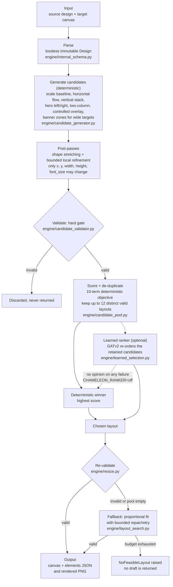

# Chameleon — design-resizing engine

Adobe North America Hackathon 2026, Chameleon challenge, stage one. The engine takes a design (an Adobe v0.9 JSON
document of text, image and shape elements) and a target canvas, and returns the **same elements** — same `id`s,
same count, same content and assets — with new positions, sizes and text font sizes so the design fits the new
canvas. It rearranges structured elements; it never edits, regenerates or redraws any image.

For each task it writes a resized design (`<task>_output.json`) and a rendered preview (`<task>_output.png`).

## Quick start (Docker, offline)

Requires Docker. Building needs network access (`apt-get`, `pip`, PyTorch's CPU wheel index, and `cr-renderer` from
GitHub); **running does not** — scoring uses `--network none`, and nothing is downloaded at run time.

```bash
docker build --platform linux/amd64 -t my-chameleon-engine .
docker run --rm --network none \
  -v "$(pwd)/input:/app/input" \
  -v "$(pwd)/output:/app/output" \
  my-chameleon-engine
```

PowerShell: use `${PWD}` instead of `$(pwd)` and a backtick instead of `\`. In Git Bash on Windows prefix the
`docker run` with `MSYS_NO_PATHCONV=1` and use `$(pwd -W)` so the container paths are not rewritten.

The container processes every `*.json` in `/app/input` and writes `<task>_output.json` and `<task>_output.png` to
`/app/output`. Three sample tasks are in `input/`. The run prints one line per task, for example
`[chameleon_sample_level2_core.json] OK in 0.97s -> chameleon_sample_level2_core_output.json, ..._output.png`, and exits 0.
A harmless `Fontconfig warning: ... unknown element "reset-dirs"` may also print.

## Input and output

**Input** — one JSON file per task in `input/`:

```json
{ "source": { "canvas": {"width": 1080, "height": 1080}, "elements": [ ... ] },
  "target_canvas": { "width": 1600, "height": 400 } }
```

`source` follows [chameleon_design_schema_v0.9.json](chameleon_design_schema_v0.9.json) (elements of type `text`,
`image`, `shape`). Other top-level keys in the sample files (`task_id`, `difficulty`, `difficulty_label`, `notes`) are ignored.

**Output** — `<task>_output.json` contains exactly `canvas` (the requested target size) and `elements`:

```json
{ "canvas": {"width": 1600, "height": 400}, "elements": [ ... same ids, same order ... ] }
```

`<task>_output.png` is that design rendered by the vendored Adobe preview renderer (`renderer/`). If no valid layout
exists for a task, the engine raises `NoFeasibleLayout`, writes nothing for that task and stops; it never returns an
unvalidated draft (see [Limitations](#limitations)).

## How it works



1. **Parse.** The input is read into an immutable `Design` that round-trips losslessly (optional-field absence vs
   `null`, unknown extension fields, element order).
2. **Generate candidates.** Layout units are derived from geometry, type and explicit groups (never from element IDs
   or notes) and placed by deterministic families: a proportional scale baseline, horizontal flow, vertical stack,
   hero-left and hero-right, two-column, controlled overlay, and, for wide targets (aspect > 2), banner zones. Two
   post-passes add variants: shape stretching (eligible buttons, bars and panels resize per axis; images never do)
   and bounded local refinement (small translations, text growth, gap and padding fixes). Every change goes through
   an allowlist: only `x`, `y`, `width`, `height` and text `font_size` can change.
3. **Validate (hard gate).** `engine/candidate_validator.py` rejects any candidate that is not schema-valid, drops or
   adds an ID, changes element order, changes a protected field (content, font family, asset, colours, …), has the
   wrong canvas size, leaves the canvas, or distorts a non-cover image by more than 5 %. Validation is separate from
   scoring: a better-scoring candidate that fails validation is never returned. The full rule list, with Official vs
   Internal labels, is [spec §8.1.1](docs/TECHNICAL_SPEC.md#811-constraint-table).
4. **Score (deterministic).** Valid candidates are scored by a ten-term objective: movement from the source,
   alignment, proximity of associated pairs, scale distortion, unwanted overlap, balance, readability (the largest
   weight), grouping, space use and blank-space coverage. Up to 64 raw candidates are generated, near-duplicates are
   removed and up to 12 distinct valid layouts are retained. The highest-scoring valid candidate is the
   deterministic winner. The weights are provisional starting values, not a validated aesthetic metric.
5. **Choose.** If the learned ranker is available it picks among the retained, already-validated candidates (next
   section); otherwise the deterministic winner is used. The choice is re-validated before it is returned.
6. **Fall back.** If the pool yields nothing valid, `resize()` uses a proportional fit with a bounded repair/retry loop
   and raises `NoFeasibleLayout` if that also fails.

### Learned ranker (integrated, on by default, optional)

`engine/learned_selection.py` re-ranks the retained candidates with a GATv2 graph network (`engine/ranker.py`,
`engine/graph_features.py`): one graph per candidate, one node per element, scored conditional on the source and
target. The shipped checkpoint is `engine/checkpoints/ranker_synth_weight_0.25_best.pt` (numeric features only; no text
encoder and no download), trained on pairwise human preferences plus AI-proposed labels that a person reviewed.

- **Fail-closed.** The checkpoint is pinned by SHA-256. If PyTorch/PyG are missing, the file or version is wrong,
  scoring raises, or the design has more than 64 elements, the deterministic winner is returned. The learned step can
  only reorder layouts that already passed validation.
- **Switch it off:** set `CHAMELEON_RANKER=off` (Docker: `docker run -e CHAMELEON_RANKER=off ...`).
- **Evidence, honestly stated.** On held-out template families the model predicted human pairwise preferences better
  than the deterministic objective (76.7 % vs 64.3 % on 98 held-out original human pairs). But in a blind 30-task
  comparison of final layouts the objective and the models were chosen about equally often (13, 13 and 14 best
  picks; no pairwise difference was significant). We make **no claim that it improves the final design**. Details and
  caveats: [docs/CREATIVE_PILOT_AND_REVIEW_TOOLS.md](docs/CREATIVE_PILOT_AND_REVIEW_TOOLS.md). The raw results (`data/`) are
  local, git-ignored development output and are not part of a clone.

## Running without Docker

Requires Python 3.10 or newer, `git` and network access for the install (`cr-renderer` is installed from GitHub).

```bash
python -m venv .venv
source .venv/bin/activate          # Windows PowerShell: .venv\Scripts\Activate.ps1
pip install -r requirements.txt
python -m engine.main
```

This runs the same pipeline on `input/*.json`. `requirements.txt` does not install PyTorch (the default PyPI wheel is
the large CUDA build), so a plain local install runs the deterministic path and logs one `learned ranker unavailable`
warning. To match the Docker image, first run
`pip install torch==2.11.0 --index-url https://download.pytorch.org/whl/cpu`.

`engine.main` also prints a quick structural self-check per task. That check is a local sanity test, **not** the
official scorer.

## Tests

```bash
pip install -r requirements-dev.txt
python -m scripts.ci_tests core        # parser, validator, generators, pool, resize; no PyTorch needed
python -m scripts.ci_tests ml          # graph features, ranker, shipped checkpoint; needs the CPU PyTorch + PyG environment in docs/CI.md
```

Use these rather than a bare `pytest`, which silently skips the ML tests when PyTorch is absent. The environments and
the execution guard are in [docs/CI.md](docs/CI.md). A local run is not a hosted-CI result.

## Verification status

**Verified on 2026-10-31** (Windows 11 host, Docker Desktop, Python 3.11):

- **Clean Docker build.** From a copy containing only the files git would include, `docker build --no-cache
  --platform linux/amd64` succeeded. The image is 2.44 GB and contains `torch 2.11.0+cpu` and `torch-geometric 2.8.1`.
- **Offline run.** `docker run --network none` on the three sample tasks wrote a JSON and a PNG for each and exited 0
  (about 1–2 s per task). The learned ranker was active in the container.
- **Fresh virtual environment.** `python -m venv`, `pip install -r requirements.txt`, `python -m engine.main` processed
  the three samples (deterministic path, with the single ranker-unavailable warning).
- **Output format.** For all three samples the output has exactly the root keys `canvas` and `elements`, `canvas`
  equals the requested target, and the element IDs and their order equal the source's.
- **Tests.** The full local `pytest` run passed in a development environment (CUDA PyTorch installed).

**Not verified:** GitHub Actions and the strict `scripts.ci_tests core` / `ml` commands; the Apple M5 Pro reference
machine (including `linux/amd64` emulation) and its resource limits; macOS, Linux hosts outside Docker, and Python 3.10;
agreement with the official scorer and renderer; any improvement in visual quality from the learned ranker.

## Limitations

- **Visual quality is unproven.** The validator guarantees structure and bounds, not good design. The only evaluation
  of final layouts against alternatives is the 30-task blind comparison above.
- **Text fit is estimated** from stored fields (a word-fit heuristic), not measured with the renderer; real renderer
  widths can differ, so some text may still overflow or be tiny on extreme canvases such as 728×90 or 90×728
  ([docs/S04_EVALUATION.md](docs/S04_EVALUATION.md)).
- The preview renderer's fidelity to the official scoring renderer is unconfirmed. The Apple M5 Pro reference machine's
  limits are unspecified; the image is `linux/amd64` and about 2.4 GB because it contains CPU PyTorch.
- On `NoFeasibleLayout` the whole batch stops (no per-task failure policy is implemented).
- The validator is stricter than Adobe's published text in places (bleed, rotation, stroke); open rule questions are in
  [Appendix F](docs/reference/F_submission_and_adobe_questions.md). The stage-one viewer add-on listed in `FAQ.md` is
  **not built**.

## Documentation and layout

| Document | Purpose |
| --- | --- |
| [docs/TECHNICAL_SPEC.md](docs/TECHNICAL_SPEC.md) | Authoritative specification: architecture, interfaces, constraints, status; Appendices A–F in [docs/reference/](docs/reference/) |
| [docs/IMPLEMENTATION_PLAN.md](docs/IMPLEMENTATION_PLAN.md) | Ownership, milestones and progress |
| [docs/CI.md](docs/CI.md) | Test and CI procedure |
| [docs/S04_EVALUATION.md](docs/S04_EVALUATION.md) | Candidate generator evaluation and known text-fit limits |
| [docs/CREATIVE_PILOT_AND_REVIEW_TOOLS.md](docs/CREATIVE_PILOT_AND_REVIEW_TOOLS.md) | Training-data pipeline, label review app, ranker training, blind evaluation |
| [AGENTS.md](AGENTS.md) | Workflow rules for coding agents |
| [RULES.md](RULES.md), [FAQ.md](FAQ.md), [chameleon_design_schema_v0.9.json](chameleon_design_schema_v0.9.json) | Official Adobe documents (not edited by us) |

```text
engine/        resize.py (entry point), main.py (CLI), internal_schema.py, candidate_generator.py, candidate_pool.py,
               candidate_validator.py, layout_objective.py, layout_search.py, shape_stretch.py, layout_refinement.py,
               learned_selection.py, ranker.py, graph_features.py, checkpoints/ (shipped model)
renderer/      Adobe's vendored preview renderer (transformer-convertor + cr-renderer)
brand_kit/     assets/ and fonts/ referenced by the sample designs
input/         sample task JSON files (three included); output/ is generated
tests/         test modules (CI runs them via scripts/ci_tests.py)
annotation/, training/, creative_pilot/, scripts/   development tooling for labels and ranker training; not used at run time
Dockerfile, requirements*.txt, chameleon_design_schema_v0.9.json
```
